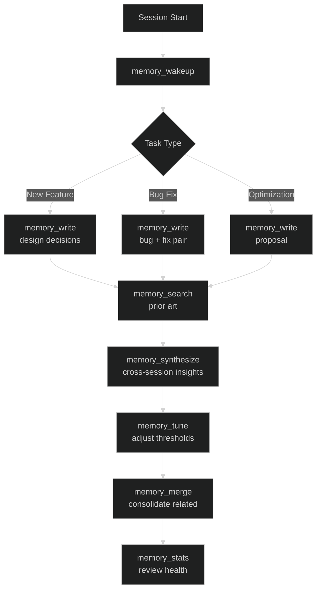
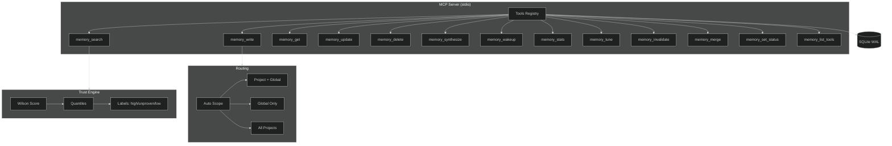

# memory-worth-mcp

> **Persistent agent memory with trust scoring and project-scoped routing** for the Model Context Protocol (MCP). 13 tools covering search, write, wakeup, synthesize, stats, tuning, merging, invalidation, and more.

---

## Quick Start

```bash
# Install globally or use via npx
npm install -g memory-worth-mcp

# Or run directly (auto-installs)
npx memory-worth-mcp
```

### MCP Configuration

Add to your `.mcp.json` or equivalent:

```json
{
  "memory-worth": {
    "command": "npx",
    "args": ["-y", "memory-worth-mcp"],
    "env": {
      "MEMORY_WORTH_PROJECT": "your-project-name"
    }
  }
}
```

Environment variables:

| Variable | Purpose | Default |
|---|---|---|
| `MEMORY_WORTH_DB` | Explicit SQLite file path | — |
| `MEMORY_WORTH_HOME` | Directory containing `memory.db` | — |
| `MEMORY_WORTH_PROJECT` | Current project name | `default` |
| `MEMORY_WORTH_DIR` | Deprecated alias for `HOME` | — |

Default DB location: `%LOCALAPPDATA%\memory-worth\memory.db` (Windows) or `XDG_DATA_HOME/memory-worth/memory.db` (Unix).

---

## Available Tools

| Tool | Description |
|---|---|
| `memory_search` | Search memories by query, scope, trust level, and tags |
| `memory_get` | Retrieve a single memory by ID |
| `memory_write` | Create a new memory (requires `applies_when`) |
| `memory_update` | Update content, trust score, tags, or status |
| `memory_delete` | Soft delete (archive) or hard delete |
| `memory_synthesize` | Combine multiple memories into a synthesized answer |
| `memory_wakeup` | Session-start digest with high-trust memories and protocol reminder |
| `memory_stats` | Project and global statistics with trust distribution and top tags |
| `memory_tune` | Adjust trust score thresholds and relabel memories |
| `memory_invalidate` | Mark a memory as superseded by another with a reason |
| `memory_merge` | Merge multiple memories into a new one, superseding originals |
| `memory_set_status` | Change status (active/archived/superseded) |
| `memory_list_tools` | List all available memory tools |

---

## Core Concepts

### Trust Scoring

Trust labels are **population quantiles** computed via Wilson score interval (95% confidence):

| Label | Meaning | Threshold |
|---|---|---|
| `high` | Co-occurred with success | Score ≥ 0.7 (75th percentile) |
| `unproven` | Too little evidence | 0.3 < Score < 0.7 |
| `low` | Co-occurred with failure | Score ≤ 0.3 (25th percentile) |

Calibration records outcomes (`success`/`failure`/`neutral`) per memory. Minimum 5 calibrations required for a non-`unproven` label.

### Project-Scoped Routing

| Scope | Behavior |
|---|---|
| `auto` | Current project + global, ranked current-first (default) |
| `project` | Current project + global |
| `global` | Global scope only |
| `all` | All projects, no ranking |

**Write scope auto-detection**: Content referencing file paths (`src/file.ts:42`), function calls (`helper()`), git SHAs (`a1b2c3d`), or project paths (`src/`) → `project` scope. Ungrounded conventions → `global` scope.

### Memory Lifecycle

```
active → (archive) → archived
active → (supersede) → superseded → (merge) → new active
```

---

## Typical Workflow



---

## Usage Examples

### Session Start (Wakeup)

```javascript
// Returns high-trust memories, recent activity, items needing review, protocol reminder
await mcp.callTool("memory_wakeup", {
  project: "my-project",
  sessionId: "abc-123"
});
```

### Record a Design Decision

```javascript
await mcp.callTool("memory_write", {
  project: "my-project",
  content: "Use requestAnimationFrame + accumulator for fixed timestep. Replaces setInterval(100ms).",
  appliesWhen: "Refactoring game loop in src/game-loop.ts:45",
  tags: ["architecture", "rendering", "performance"],
  sessionId: "abc-123"
});
```

### Record Bug + Fix Pair

```javascript
// Bug
const bug = await mcp.callTool("memory_write", {
  project: "my-project",
  content: "Self-collision on rapid direction reversal. Root cause: collision check after unshift.",
  appliesWhen: "Fixing collision in src/snake.ts:180",
  tags: ["bug", "collision", "critical"]
});

// Fix
const fix = await mcp.callTool("memory_write", {
  project: "my-project",
  content: "Prevent 180° reversal in input handler. Check: if (newDx === -dx && newDy === -dy) return;",
  appliesWhen: "Applying fix to src/snake.ts:210",
  tags: ["fix", "collision", "resolved"]
});

// Calibrate: mark fix as successful
await mcp.callTool("memory_update", {
  id: fix.id,
  trustScore: 0.9  // Becomes "high" trust
});
```

### Search with Trust Filtering

```javascript
await mcp.callTool("memory_search", {
  query: "collision",
  scope: "project",
  project: "my-project",
  minTrust: 0.7,      // Only high-trust
  tags: ["resolved"],
  limit: 10
});
```

### Synthesize Cross-Session Knowledge

```javascript
await mcp.callTool("memory_synthesize", {
  memoryIds: ["id1", "id2", "id3"],
  project: "my-project",
  question: "What are all known collision issues and their fixes?"
});
```

---

## Prerequisites

| Tool | Minimum Version | Purpose |
|---|---|---|
| Node.js | 20+ | MCP server runtime |
| npm | 10+ | Package management |

---

## Development

```bash
# Clone
git clone https://github.com/simwai/memory-worth-mcp.git
cd memory-worth-mcp

# Install dependencies
npm install

# Run tests
npm test

# Build
npm run build

# Run server locally
npm run dev

# Dry-run release
npm run release:dry:patch
```

### Release Commands

| Command | Effect |
|---|---|
| `npm run version:patch` | Bump patch (1.0.0 → 1.0.1), create git tag |
| `npm run version:minor` | Bump minor (1.0.0 → 1.1.0), create git tag |
| `npm run version:major` | Bump major (1.0.0 → 2.0.0), create git tag |
| `npm run release:patch` | Full release: test → build → version → publish → push tags |
| `npm run release:minor` | Full minor release |
| `npm run release:major` | Full major release |
| `npm run release:dry:patch` | Preview patch release without changes |

---

## Architecture



---

## Project Structure

```
memory-worth-mcp/
├── package.json
├── tsconfig.json
├── .gitignore
├── README.md
├── LICENSE
├── scripts/
│   └── release.js
├── src/
│   ├── mcp-server.ts          # McpServer with 13 registerTool calls
│   ├── db/
│   │   └── index.ts           # SQLite schema + initialization
│   ├── trust/
│   │   └── index.ts           # Wilson score, calibration, quantiles
│   ├── routing/
│   │   └── index.ts           # Scope resolution, write detection
│   ├── tools/
│   │   ├── index.ts           # Tool registry
│   │   ├── memory-search.ts
│   │   ├── memory-get.ts
│   │   ├── memory-write.ts
│   │   ├── memory-update.ts
│   │   ├── memory-delete.ts
│   │   ├── memory-synthesize.ts
│   │   ├── memory-wakeup.ts
│   │   ├── memory-stats.ts
│   │   ├── memory-tune.ts
│   │   ├── memory-invalidate.ts
│   │   ├── memory-merge.ts
│   │   ├── memory-set-status.ts
│   │   └── memory-list-tools.ts
│   ├── types/
│   │   └── index.ts           # TypeScript interfaces
│   └── utils/
│       └── paths.ts           # DB path resolution
└── tests/
    └── core.test.ts           # 15 tests (trust + routing)
```

---

## License

ISC — see [LICENSE](LICENSE).

---

## Related

- [MCP Specification](https://modelcontextprotocol.io/)
- [prompt-system/10-doc-style.md](../perplexity-prompts/prompt-system/10-doc-style.md) — Documentation conventions used here